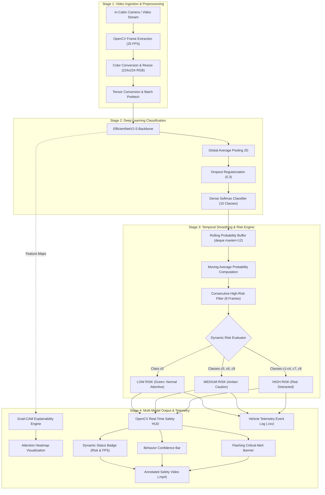

# 🚗 Driver Behaviour Detection System for Intelligent Vehicle Safety

[](https://www.python.org/)
[](https://tensorflow.org)
[](https://opencv.org/)
[](LICENSE)

An end-to-end, real-time **Driver Behaviour Detection System** engineered for Advanced Driver Assistance Systems (ADAS). Powered by deep transfer learning on **EfficientNetV2-S**, the system detects driver distraction states, explains predictions via **Grad-CAM**, filters temporal noise, and renders in-cabin **Safety HUD warnings** with automated telemetry logging.

---

## 🌟 Key Features

- **High-Performance Backbone:** Fine-tuned `EfficientNetV2-S` trained on 10 driver behavior classes, capturing fine-grained hand positions and device interactions.
- **Explainable AI (XAI):** Integrated **Grad-CAM** visualizer generating class-activation heatmaps to verify focus on steering wheels, phones, and vehicle controls.
- **Temporal Smoothing Engine:** Rolling window probability buffer (`deque`) and consecutive-frame confirmation logic (8 frames) to eliminate single-frame flickering and false alarms.
- **Three-Tier Risk Assessment:**
  - 🟢 **LOW Risk:** Safe driving (`c0`)
  - 🟠 **MEDIUM Risk:** Operating radio, drinking, talking to passenger (`c5`, `c6`, `c9`)
  - 🔴 **HIGH Risk:** Texting, talking on phone, reaching behind, makeup (`c1`–`c4`, `c7`, `c8`)
- **Automated Vehicle Safety HUD:** Real-time OpenCV heads-up display overlay showing risk level, behavior confidence bars, live FPS, and flashing critical warning banners.
- **Telemetry Event Logging:** Automated export to `driver_event_log.csv` tracking timestamps, frame indices, confidence scores, and safety alert states.

---

## 🏗️ Architecture Pipeline

### 1. Visual End-to-End Pipeline



---

### 2. Detailed Pipeline Breakdown

| Pipeline Stage | Module / Component | Technical Implementation & Purpose |
| :--- | :--- | :--- |
| **1. Acquisition & Preprocessing** | `OpenCV` + `tf.data` | Ingests raw video/webcam frames, resizes to 224x224 RGB, and prefetches batches for sub-millisecond pipeline throughput. |
| **2. Feature Extraction** | `EfficientNetV2-S` Backbone | Pretrained convolutional network with inverted bottleneck blocks, fine-tuned on the upper 120 layers to isolate driver hands, head tilt, and handheld devices. |
| **3. Classification Head** | `GAP` + `Dropout(0.3)` + `Dense(10)` | Aggregates spatial feature maps into a 10-class softmax distribution across safe and distracted driving behaviors. |
| **4. Explainability (XAI)** | `Grad-CAM` | Computes gradients of target class scores with respect to final conv layers, visually proving model attention on phones, wheels, and controls. |
| **5. Temporal Smoothing** | `DriverBehaviorAnalyzer` | Employs a rolling FIFO queue (`deque(maxlen=12)`) to average frame probabilities, preventing erratic label flickers. |
| **6. False-Alarm Suppression** | 8-Frame Persistence Filter | Driver must continuously exhibit high-risk behavior for >= 8 consecutive frames before triggering an active alert, filtering out brief glances. |
| **7. Safety HUD Generation** | `draw_safety_hud` | Renders an in-cabin dashboard HUD with color-coded risk badges, behavior confidence bars, live FPS telemetry, and flashing alert banners. |
| **8. Telemetry Event Logging** | `driver_event_log.csv` | Automatically records ISO timestamps, frame indices, predicted behaviors, confidence metrics, and active alert statuses for safety auditing. |

---

## 📊 Dataset & Target Behaviors (State Farm Dataset)

| Class | Description | Risk Level |
| :---: | :--- | :---: |
| `c0` | Safe driving | 🟢 LOW |
| `c1` | Texting - right hand | 🔴 HIGH |
| `c2` | Talking on phone - right hand | 🔴 HIGH |
| `c3` | Texting - left hand | 🔴 HIGH |
| `c4` | Talking on phone - left hand | 🔴 HIGH |
| `c5` | Operating radio | 🟠 MEDIUM |
| `c6` | Drinking | 🟠 MEDIUM |
| `c7` | Reaching behind | 🔴 HIGH |
| `c8` | Hair and makeup | 🔴 HIGH |
| `c9` | Talking to passenger | 🟠 MEDIUM |

---

## 📈 System Outputs & Experimental Results

### 1. Model Evaluation Metrics

Evaluated using a driver-independent split (`driver_imgs_list.csv`) to test on completely unseen drivers:

| Metric | Score |
| :--- | :---: |
| **Training Accuracy** | **99.62%** |
| **Validation Accuracy (Unseen Drivers)** | **~71%** |
| **Weighted Precision** | **0.72** |
| **Weighted Recall** | **0.71** |
| **Weighted F1-Score** | **0.71** |
| **Real-Time Inference Speed** | **~25–40 FPS** |

---

### 2. Sample Telemetry Event Log (`driver_event_log.csv`)

| Timestamp | Frame | Detected Behavior | Confidence | Risk Level | Alert Active |
| :--- | :---: | :--- | :---: | :---: | :---: |
| `2026-10-12 18:30:51.668` | 1 | Safe driving | 98.2% | `LOW` | `False` |
| `2026-10-12 18:30:52.225` | 2 | Safe driving | 98.6% | `LOW` | `False` |
| `2026-10-12 18:30:58.521` | 16 | Texting - right hand | 94.8% | `HIGH` | `False` |
| `2026-10-12 18:31:01.442` | 24 | Texting - right hand | 98.7% | `HIGH` | `True` *(Alert Active)* |
| `2026-10-12 18:31:08.115` | 40 | Operating radio | 92.4% | `MEDIUM` | `False` |

---

## 📁 Repository File Structure

```
driver-behaviour-detection-system/
├── README.md                              # Complete Project Documentation
├── requirements.txt                      # Python Dependencies
├── Driver_Behavior_Detection_System.ipynb # Full Training, Grad-CAM & HUD Notebook
├── outputs/
│   ├── driver_safety_h264.mp4            # Annotated Safety HUD Video Demonstration
│   └── driver_event_log.csv              # Exported Vehicle Telemetry Audit Log
└── models/                               # Pretrained model weights (via GitHub Releases)
```

---

## 🛠️ Tech Stack

- **Deep Learning:** TensorFlow 2.x / Keras 3
- **Backbone Architecture:** EfficientNetV2-S (Pretrained on ImageNet)
- **Computer Vision:** OpenCV (`cv2`)
- **Explainable AI:** Grad-CAM (Gradient-weighted Class Activation Mapping)
- **Data Engineering:** `tf.data` API with mixed precision acceleration (`mixed_float16`)
- **Video Encoding:** FFmpeg (`libx264` H.264 standard)
- **Data Analytics:** NumPy, Pandas, Scikit-Learn, Seaborn, Matplotlib

---

## 📜 License

This project is open-source under the [MIT License](LICENSE).
